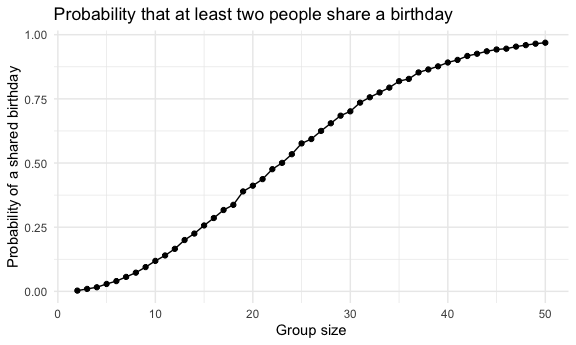

Homework 5
================
Andrea Vasquez
2026-11-14

- [Problem 1.](#problem-1)
  - [1.1 Building birthday function](#11-building-birthday-function)
  - [1.2 Testing birthday function](#12-testing-birthday-function)
  - [1.3 Applying birthday function to n = 2:50, 10,000
    times.](#13-applying-birthday-function-to-n--250-10000-times)
  - [Plot 1: Probability of a shared birthday as a function of group
    size.](#plot-1-probability-of-a-shared-birthday-as-a-function-of-group-size)

## Problem 1.

### 1.1 Building birthday function

``` r
birthday_repeated = function(n_room) {

  birthdays = sample(1:365, size = n_room, replace = TRUE)

  repeated_bday = length(unique(birthdays)) < n_room

  repeated_bday

}
```

### 1.2 Testing birthday function

``` r
birthday_repeated(10)
```

    ## [1] TRUE

### 1.3 Applying birthday function to n = 2:50, 10,000 times.

``` r
birthday_results_df =
  expand_grid(
    number_of_people = 2:50,
    iter = 1:10000
  ) |>
  mutate(
    repeated = map_lgl(number_of_people, birthday_repeated)
  ) |>
  group_by(number_of_people) |>
  summarize(prob_of_repeat = mean(repeated))
```

### Plot 1: Probability of a shared birthday as a function of group size.

``` r
birthday_results_df |>
  ggplot(aes(x = number_of_people, y = prob_of_repeat)) +
  geom_point() +
  geom_line() +
  labs(
    title = "Probability that at least two people share a birthday",
    x = "Group size",
    y = "Probability of a shared birthday"
  )
```



``` r
first_over_half =
  birthday_results_df |>
  filter(prob_of_repeat > 0.5) |>
  pull(number_of_people) |>
  min()

prob_23 =
  birthday_results_df |>
  filter(number_of_people == 23) |>
  pull(prob_of_repeat)

prob_50 =
  birthday_results_df |>
  filter(number_of_people == 50) |>
  pull(prob_of_repeat)
```

The probability that at least two people share a birthday increases
quickly and non-linearly with group size. It is close to 0 for very
small groups, but by around group size of 23 it goes above 50%
(estimated mean = 0.501). By a group size of 50, the estimated
probability is 0.969, so a shared birthday is almost certain. This is
much higher than most people would guess, because the number of possible
pairs of people grows much faster than the number of people.
