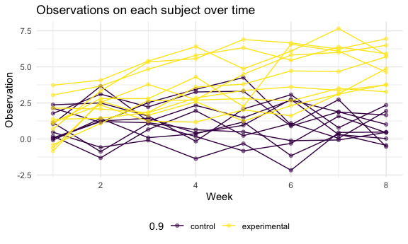

Homework 5
================
Andrea Vasquez
2026-11-14

- [Problem 1.](#problem-1)
  - [1.1 Building birthday function](#11-building-birthday-function)
  - [1.2 Testing birthday function](#12-testing-birthday-function)
  - [1.3 Applying birthday function to n = 2:50, 10,000
    times.](#13-applying-birthday-function-to-n--250-10000-times)
  - [Plot 1: Probability of a shared birthday as a function of group
    size.](#plot-1-probability-of-a-shared-birthday-as-a-function-of-group-size)
- [Problem 2](#problem-2)
  - [2.1: Import data](#21-import-data)
  - [2.2 Spaghetti plot](#22-spaghetti-plot)

## Problem 1.

### 1.1 Building birthday function

``` r
birthday_repeated = function(n_room) {

  birthdays = sample(1:365, size = n_room, replace = TRUE)

  repeated_bday = length(unique(birthdays)) < n_room

  repeated_bday

}
```

### 1.2 Testing birthday function

``` r
birthday_repeated(10)
```

    ## [1] FALSE

### 1.3 Applying birthday function to n = 2:50, 10,000 times.

``` r
birthday_results_df =
  expand_grid(
    number_of_people = 2:50,
    iter = 1:10000
  ) |>
  mutate(
    repeated = map_lgl(number_of_people, birthday_repeated)
  ) |>
  group_by(number_of_people) |>
  summarize(prob_of_repeat = mean(repeated))
```

### Plot 1: Probability of a shared birthday as a function of group size.

``` r
birthday_results_df |>
  ggplot(aes(x = number_of_people, y = prob_of_repeat)) +
  geom_point() +
  geom_line() +
  labs(
    title = "Probability that at least two people share a birthday",
    x = "Group size",
    y = "Probability of a shared birthday"
  )
```


``` r
first_over_half =
  birthday_results_df |>
  filter(prob_of_repeat > 0.5) |>
  pull(number_of_people) |>
  min()

prob_23 =
  birthday_results_df |>
  filter(number_of_people == 23) |>
  pull(prob_of_repeat)

prob_50 =
  birthday_results_df |>
  filter(number_of_people == 50) |>
  pull(prob_of_repeat)
```

The probability that at least two people share a birthday increases
quickly and non-linearly with group size. It is close to 0 for very
small groups, but by around group size of 23 it goes above 50%
(estimated mean = 0.52). By a group size of 50, the estimated
probability is 0.972, so a shared birthday is almost certain. This is
much higher than most people would guess, because the number of possible
pairs of people grows much faster than the number of people.

## Problem 2

### 2.1: Import data

``` r
study_df = 
  tibble(
    files = list.files("data/"),
    path = str_c("data/", files)
  ) |> 
  mutate(data = map(path, read_csv, show_col_types = FALSE)) |> 
  unnest(data) |> 
  mutate(files = str_remove(files, ".csv")) |> 
  separate(files, into = c("arm", "subject_id"), sep = "_") |> 
  mutate(
    arm = case_match(
      arm, 
      "con" ~ "control", 
      "exp" ~ "experimental"
    )
  ) |> 
  pivot_longer(
    week_1:week_8,
    names_to = "week",
    names_prefix = "week_",
    values_to = "observation"
  ) |> 
  mutate(week = as.numeric(week)) |> 
  select(arm, subject_id, week, observation)
```

    ## Warning: There was 1 warning in `mutate()`.
    ## ℹ In argument: `arm = case_match(arm, "con" ~ "control", "exp" ~
    ##   "experimental")`.
    ## Caused by warning:
    ## ! `case_match()` was deprecated in dplyr 1.2.0.
    ## ℹ Please use `recode_values()` instead.

``` r
study_df
```

    ## # A tibble: 160 × 4
    ##    arm     subject_id  week observation
    ##    <chr>   <chr>      <dbl>       <dbl>
    ##  1 control 01             1        0.2 
    ##  2 control 01             2       -1.31
    ##  3 control 01             3        0.66
    ##  4 control 01             4        1.96
    ##  5 control 01             5        0.23
    ##  6 control 01             6        1.09
    ##  7 control 01             7        0.05
    ##  8 control 01             8        1.94
    ##  9 control 02             1        1.13
    ## 10 control 02             2       -0.88
    ## # ℹ 150 more rows

The tidy dataset has 160 rows, with one row per subject per week (8
weeks total), and 20 subjects in total – 10 subjects per arm.

### 2.2 Spaghetti plot

``` r
study_df |>
  ggplot(aes(x = week, y = observation, group = str_c(arm, subject_id), color = arm)) +
  geom_line() +
  geom_point(alpha = .5) +
  scale_color_viridis_d((end = 0.9)) +
  labs(
    title = "Observations on each subject over time",
    x = "Week",
    y = "Observation",
    color = "Arm"
  )
```



``` r
arm_means_df = 
  study_df |> 
  filter(week %in% c(1, 8)) |> 
  group_by(arm, week) |> 
  summarize(mean_obs = mean(observation), .groups = "drop")

con_wk1 = arm_means_df |> 
  filter(arm == "control", week == 1) |>
  pull(mean_obs)

con_wk8 = arm_means_df |> 
  filter(arm == "control", week == 8) |> 
  pull(mean_obs)

exp_wk1 = arm_means_df |> 
  filter(arm == "experimental", week == 1) |> 
  pull(mean_obs)

exp_wk8 = arm_means_df |> 
  filter(arm == "experimental", week == 8) |> 
  pull(mean_obs)
```

At week 1, the two arms look similar, with a mean observation of 0.92 in
the control arm and 1.14 in the experimental arm. Over the 8 weeks,
observations in the control arm stay roughly flat until it slightly
decreases towards week 8 (mean = 0.74). In contrast, observations in the
experimental arm increase steadily over time, reaching a mean of 5.12 at
week 8. By the end of the study, nearly all experimental subjects have
higher values than control subjects. There is also substantial
week-to-week variability within subjects in both arms.

It is important to note that some observations are negative, mostly in
the control arm. However, since the homework does not describe what is
being measured, these values were kept as recorded.
